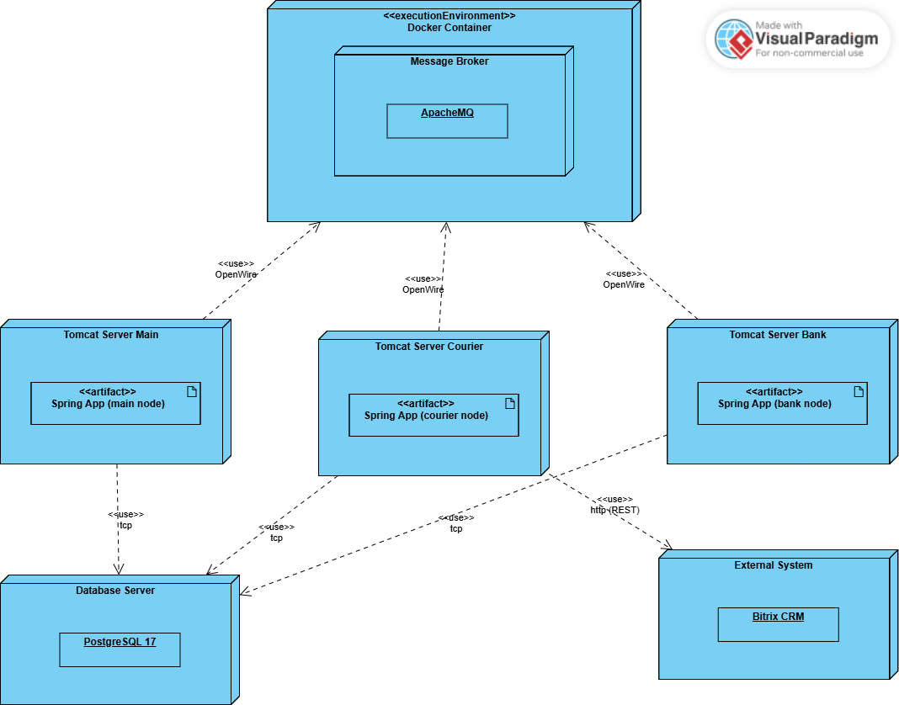
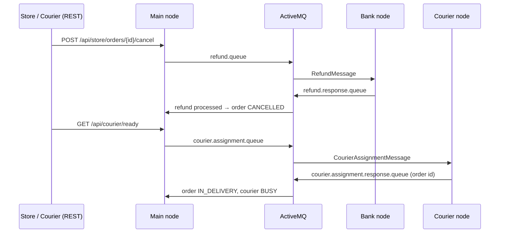
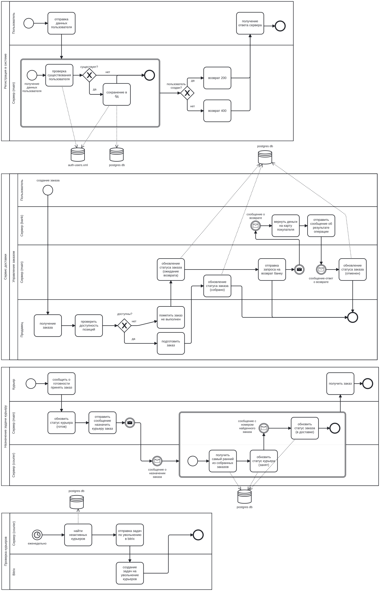

# Delivery Orchestrator

A delivery backend split into three Spring Boot nodes that talk over ActiveMQ.
Stores collect orders, couriers pick them up, and a separate bank node handles refunds.
Every step that touches both the database and the broker runs in one XA transaction,
so a refund or a courier assignment is never lost or applied twice when a node goes down.

**Stack:** Java 17 · Spring Boot 3.4 · Spring Data JPA · Spring Security · Spring JMS · ActiveMQ 5 · Narayana JTA · PostgreSQL 17 · JCA · Camunda 7 (branch `lab4`) · OpenAPI · Maven

## Architecture



| Node | Profile | Port | Responsibility |
|---|---|---|---|
| Main | `main` | 8081 | REST API for customers, stores and couriers; owns orders |
| Bank | `bank` | 8082 | Processes refunds for cancelled orders |
| Courier | `courier` | 8083 | Assigns the oldest collected order to a ready courier; weekly inactivity check |

All three nodes are built from one codebase and started with a different Spring profile.
They share PostgreSQL and exchange JSON messages through four queues:



## How consistency is kept

- **One transaction for the database and the broker.** The ActiveMQ connection factory is an
  `ActiveMQXAConnectionFactory` wrapped for Narayana, so the JMS session and the JPA connection
  enlist in the same JTA transaction. Changing an order status and sending the next message either
  both commit or both roll back.
- **Transacted listeners.** Listener containers use `SESSION_TRANSACTED` with the JTA transaction
  manager. If processing fails, the message goes back to the queue instead of disappearing.
- **Explicit propagation.** The courier node opens `REQUIRES_NEW` for each assignment, the main node
  applies the response under `MANDATORY`, so a response is never handled outside a transaction.
- **Concurrency.** Each listener runs 3 to 10 consumers, and status checks (`READY`, `COLLECTED`,
  `REFUND_PROCESSING`) make repeated or late messages harmless.

## Business process

The BPMN 2.0 model covers registration, order creation, collection, delivery and cancellation
with a refund through the bank.



Order lifecycle: `CREATED → COLLECTED → IN_DELIVERY → DELIVERED`, or `REFUND_PROCESSING → CANCELLED`.

## Bitrix24 integration over JCA

The courier node runs a weekly `@Scheduled` job that finds couriers who have not taken an order for
seven days and creates a dismissal task for HR in Bitrix24. The call goes through a custom
JCA resource adapter (`BitrixConnectionFactory`, `BitrixInteraction`, `BitrixMappedRecord`) that wraps
the Bitrix24 REST API, the same way an enterprise application would talk to an external EIS.

## Security

HTTP Basic with Spring Security. Users and roles (`STORE`, `COURIER`) are stored in an XML file
that the app reads and writes through JAXB. A store sees only its own orders, a courier only the
orders assigned to them.

## Camunda edition (branch `lab4`)

The [`lab4`](../../tree/lab4) branch moves the order flow into an embedded Camunda 7 engine:

- two executable BPMN processes, `store-order-process` and `courier-order-process`;
- service tasks are Spring `JavaDelegate` beans (`CreateOrderDelegate`, `CollectOrderDelegate`,
  `AssignOrderToCourierDelegate`, `CloseOrderDelegate`, `CancelOrderDelegate`);
- stores and couriers complete user tasks in Camunda Tasklist, and users live in Camunda identity
  instead of the XML file.

| Store order process | Courier order process |
|---|---|
|  |  |

## Run locally

```bash
docker run -d -p 61616:61616 -p 8161:8161 rmohr/activemq:5.15.9-alpine   # console: http://localhost:8161/admin
# PostgreSQL with database delivery_service on localhost:5432
export BITRIX_WEBHOOK_URL=https://<portal>.bitrix24.ru/rest/1/<webhook-token>/

mvn spring-boot:run -Dspring-boot.run.main-class=com.delivery.MainNodeApplication
mvn spring-boot:run -Dspring-boot.run.main-class=com.delivery.BankNodeApplication
mvn spring-boot:run -Dspring-boot.run.main-class=com.delivery.CourierNodeApplication
```

API docs: `api-docs.json` (OpenAPI) and an Insomnia collection in `insomnia_request_collection.yaml`.

## Branches

| Branch | What it adds |
|---|---|
| `lab1` | REST API and the BPMN model of the process |
| `lab2` | Declarative JTA transactions and role-based security |
| `master` | Three nodes over ActiveMQ with XA transactions and the Bitrix24 JCA connector |
| `lab4` | The same flow orchestrated by Camunda 7 |

---
Built as coursework for the Business Logic of Software Systems course at ITMO University, 2025.
